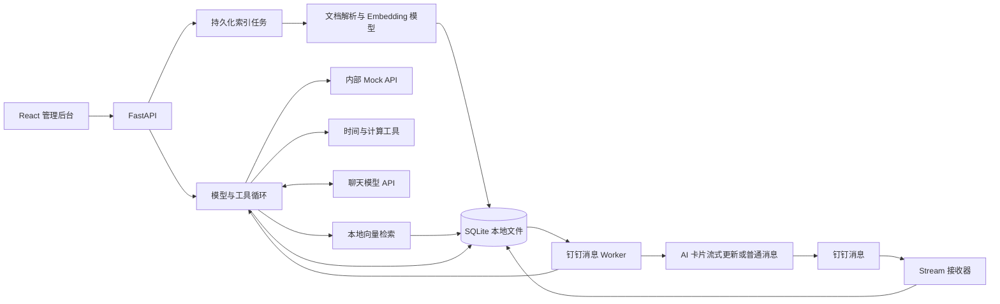

# 小苏 · 本地 AI 助手

> 提交版更新（2026-11-22）：已找到并收录真实评测报告，26条执行完成，综合通过率61.54%（16/26），工具名称覆盖率100%，运行异常0条。详见 [评测记录](docs/evaluation/README.md)。下文关于“当时连接失败”的描述是早期尝试记录，不代表最新结果。原始开发目录未被修改。本副本不含密钥、运行数据库、日志和依赖缓存。


主项目使用 FastAPI + React + SQLite。无需 Docker、PostgreSQL、pgvector，也不需要手动创建数据库。首次启动自动创建 data/xiaosu.sqlite3。

小苏面向公司制度问答和业务信息查询：上传文档后进行带来源的知识问答，由模型自主选择工具查询员工、打卡、订单及时间。支持网页流式聊天、钉钉 AI 卡片流式回复，以及文档管理、模型配置、对话记录查询。

业务接口目前使用模拟数据，不代表已接入真实公司系统。2026-11-22 用户已确认钉钉流式回复正常；其他验收边界见文末。

## 技术栈

| 层次 | 技术 |
|---|---|
| 前端 | React 19、TypeScript、Ant Design、Vite |
| 后端 | Python 3.11+、FastAPI、Uvicorn、Pydantic |
| 存储与迁移 | SQLite、SQLAlchemy、Alembic |
| 模型与检索 | OpenAI 兼容 SDK、Embedding、余弦相似度 |
| 文档解析 | pypdf、python-docx、UTF-8 文本解析 |
| 钉钉 | dingtalk-stream 消息接收、AI 卡片 HTTP API |
| 工程与测试 | uv、pnpm、pytest、httpx、Mock LLM |

## 安装

以下是安装流程，以项目放在 `D:\xiaosu` 为例。无需安装 Docker、PostgreSQL 或其他数据库服务。首次安装依赖需要联网。

### 1. 安装基础工具

安装 [Git for Windows](https://git-scm.com/downloads/win)（包含 Git Bash）和 [Node.js](https://nodejs.org/)（使用22.13或更新的兼容版本）。项目指定 `pnpm@11.25.0`，后端要求 Python 3.11+。

在 PowerShell 中安装 uv：

```powershell
winget install --id=astral-sh.uv -e
```

若电脑没有 winget，可参考 [uv 官方安装说明](https://docs.astral.sh/uv/getting-started/installation/) 选择其他安装方式。安装完成后重新打开 PowerShell，再安装 pnpm 和 Python：

```powershell
npm.cmd install -g pnpm@11.25.0
uv python install 3.11
```

确认工具可用：

```powershell
uv --version
node --version
pnpm.cmd --version
& "C:\Program Files\Git\bin\bash.exe" --version
```

Git 默认路径通常是 `C:\Program Files\Git\bin\bash.exe`；本项目原开发电脑使用 `D:\Git\bin\bash.exe`。后续命令中的路径必须按实际安装位置替换。出现“找不到命令”时，先重新打开终端，并检查安装路径及 PATH。


### 3. 安装项目依赖

```powershell
cd D:\xiaosu
& "C:\Program Files\Git\bin\bash.exe" scripts/setup.sh
```

首次安装需要网络，脚本安装前后端及钉钉依赖；缺少 `.env` 时从 `.env.example` 复制，已有配置不覆盖。

### 4. 填写配置

编辑根目录 `.env`：将 `ADMIN_SECRET` 设置为自己的后台登录口令，按下文“配置模型”填写 `LLM_*` 和 `EMBEDDING_*`。使用钉钉时还需填写 `DINGTALK_CLIENT_ID`、`DINGTALK_CLIENT_SECRET`，流式卡片需填写 `DINGTALK_CARD_TEMPLATE_ID` 并发布匹配模板。已有 `.env` 可复用，但应检查是否含旧电脑绝对路径或不可访问的地址。

复制已有知识库时，如更换 Embedding 模型或接口，启动后需重建索引。此安装流程已核对项目脚本，尚未在另一台干净电脑完成完整验收。

## 启动

完成安装和配置后，在新电脑 PowerShell 中执行：

```powershell
cd D:\xiaosu
& "C:\Program Files\Git\bin\bash.exe" scripts/start.sh
```

缺少 .env 或依赖时脚本自动调用 setup.sh；随后自动创建数据库、执行迁移，启动后端、内部 Mock API、索引 worker 和 React 前端。填写完整钉钉凭据后，同一命令也会启动钉钉接收和消息处理服务；Ctrl+C 统一停止这些子进程。无需另开钉钉启动窗口。

- 后台：http://localhost:5173
- 默认本地登录口令：xiaosu-local-dev（可在 .env 修改 ADMIN_SECRET）
- 后端接口：http://127.0.0.1:8000/docs
- 内部 Mock API：http://127.0.0.1:8001/docs

所有开发服务仅监听本机。运行期间保留启动终端，推荐用 Ctrl+C 正常停止，等待命令提示符重新出现。


### 钉钉与来源链接

在项目根目录 `.env` 中填写 `DINGTALK_CLIENT_ID` 和 `DINGTALK_CLIENT_SECRET`，然后重启。完整填写后，终端会显示“钉钉接入已启用，将与后台一起启动”；未填写完整时只启动 Web。该提示说明服务已启动，实际连接是否成功还需查看后续日志并在钉钉中发送问题验证。

正常使用统一启动命令，不要同时运行 `scripts/im.sh`。修改钉钉回答展示代码后，也要通过上述步骤重启，让消息处理服务加载新代码。

`PUBLIC_BASE_URL` 决定回答中的来源链接地址，默认是 `http://localhost:8000`。这个地址仅适合在运行小苏的电脑上打开；手机或其他电脑中的 localhost 指向它们自己，无法访问本机文档。需要跨设备访问时，应先配置可访问的后端地址及适当的访问保护，再修改 `PUBLIC_BASE_URL` 并重启；仅修改该变量不会自动开放网络访问。

## 配置模型

聊天与语义检索是两个独立模型。根目录 .env 必须分别填写：

```dotenv
LLM_API_KEY=聊天模型密钥
LLM_BASE_URL=聊天接口基础地址
LLM_MODEL=支持工具调用和流式的聊天模型名
EMBEDDING_API_KEY=向量模型密钥
EMBEDDING_BASE_URL=支持 embeddings 接口的基础地址
EMBEDDING_MODEL=实际可用的语义向量模型名
```

## 基础使用

文档管理支持批量操作：点击“批量上传文档”，在文件选择器中使用 Ctrl/Shift 选择多个文件；上传按文件依次处理，并显示进度、成功数量和失败原因。上传成功后仍需等待 `indexed`。勾选文档表格左侧复选框，点击“批量删除”并确认即可；成功删除的选项清除，失败项保留以便重试。批量操作复用单文件接口，部分失败不会回滚已成功的文件。


## 架构



SQLite WAL 与 BEGIN IMMEDIATE 事务用于短写入；跨进程文件锁串行化同一会话及 worker；耗时模型调用不持有数据库写锁。适用于笔试规模的单机小知识库，不面向大型并发服务。

## 开发入口

- scripts/start.sh、dev.sh、local.sh：同一本地启动流程。
- scripts/setup.sh：安装依赖，不修改已存在的 .env。
- scripts/test.sh：自动化测试，使用临时 SQLite 与 Mock LLM，不需要真实密钥。
- scripts/seed.sh：导入示例资料；数据库初始化后使用。
- scripts/im.sh：独立调试入口；正常使用统一启动命令，不要重复运行。

运行数据位于 `data/`，日志位于 `logs/`，配置位于 `.env`；提交项目时排除这些运行数据和密钥。前端使用 pnpm/ESM，后端使用 uv/.venv。

详细流程见 docs/ARCHITECTURE.md；docs/TASKS.md 含早期阶段记录，当前完成情况以本 README 的日期与验证说明为准。

## Roadmap

| 阶段 | 内容 | 状态 |
|---|---|---|
| 基础问答 | 文档上传、索引、引用、多轮、网页流式 | 已实现，继续积累质量验收样例 |
| 工具调用 | 模型自主选择员工/打卡/订单/时间/计算工具 | 已实现，模拟接口集成检查通过 |
| 钉钉接入 | 消息接收、AI 卡片流式、普通消息回退 | 已实现，用户确认当前环境效果正常 |
| 工程保障 | 日志落盘、错误兜底、Mock LLM 自动测试、启动文档 | 已实现，测试结果见上文 |
| 提交前验收 | 补齐 PDF 样例、真实模型工具调用、多轮及失败场景记录，更新历史文档 | 待完成 |
| 后续扩展 | 真实业务 API、可编辑数据管理、OCR/旧版 DOC、跨设备来源访问 | 尚未实现，按需推进 |

`bash scripts/test.sh` 运行测试和前端构建；`--backend` 只运行后端；`--smoke` 检查运行中的服务，未配置 Embedding 时验证失败提示，不宣称索引成功。
